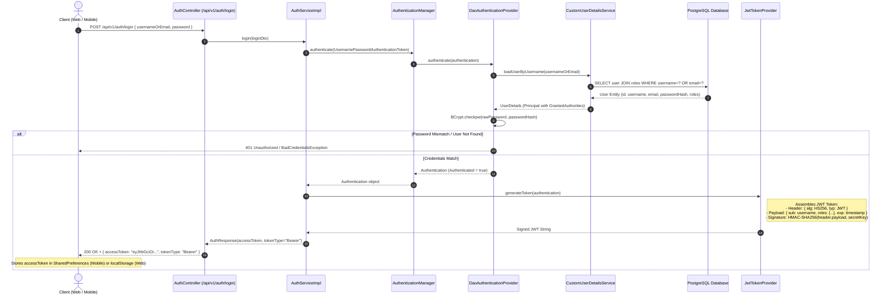
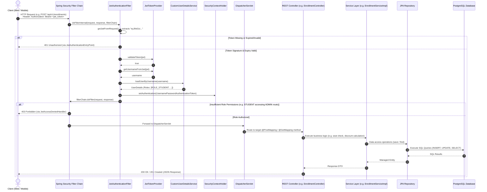

# School Management System - Backend (Spring Boot 3)

Backend RESTful API service for the School Management System built with Spring Boot 3, Spring Data JPA, PostgreSQL, Spring Security 6 with JWT, and Docker.

---

## 🚀 Features

- **Authentication & Authorization**:
  - Role-based Access Control (`ROLE_ADMIN`, `ROLE_TEACHER`, `ROLE_STUDENT`)
  - Stateless JWT token authentication
  - User self-registration with automatic student profile provisioning
- **Academic Management**:
  - **Departments**: Manage academic faculties & departments
  - **Teachers**: Manage instructors with detailed teacher profiles
  - **Courses**: Manage course offerings, credit hours, seat capacities, and teacher assignments
  - **Students**: Student records, demographic info, and enrollment tracking
  - **Enrollments**: Transactional course enrollment, automatic seat inventory deduction, discount percentage calculation, receipt generation, and dropping/canceling courses with automatic seat restocking
- **Architecture**:
  - Layered Clean Architecture (Controller -> Service -> Repository -> Entity)
  - Data Transfer Objects (DTOs) and ModelMapper
  - JPA Specifications for dynamic filtering, searching, and pagination
  - Global Exception Handling with structured API responses

---

## 🛠️ Tech Stack

- **Java**: 21 (Eclipse Temurin)
- **Framework**: Spring Boot 3.x
- **Database**: PostgreSQL
- **Security**: Spring Security & JWT (jjwt 0.12.6)
- **Build Tool**: Maven (`mvnw`)
- **Containerization**: Docker & Docker Compose
- **API Documentation**: OpenAPI 3 / Swagger (`/swagger-ui.html`)

---

## 🔐 Security Architecture & Request Flow

The backend uses **stateless token-based authentication** powered by Spring Security 6 and JSON Web Tokens (JWT). The server does not store user sessions in memory; instead, every client request carries a digitally signed cryptographic token.

### 1. High-Level Request Pipeline

```mermaid
flowchart TD
    Client["Client (React Web / Flutter Mobile)"]
    
    subgraph SpringSecurity ["Spring Security 6 (Stateless Layer)"]
        Cors["1. CorsFilter (CORS Header Check)"]
        JwtFilter["2. JwtAuthenticationFilter (Extract & Verify)"]
        JwtProvider["JwtTokenProvider (HMAC-SHA256 & Claims)"]
        SecCtx["SecurityContextHolder (Principal & Authorities)"]
        AuthZ["3. AuthorizationFilter (Role Verification)"]
    end
    
    subgraph SpringMVC ["Spring Boot Application Layers"]
        Dispatcher["DispatcherServlet"]
        Controller["REST Controller (@RestController)"]
        Service["Service Layer (@Service - Business Logic)"]
        Repo["Data Access Layer (@Repository - JPA / Hibernate)"]
    end
    
    subgraph Database ["Persistence Layer"]
        Postgres[("PostgreSQL Database")]
    end
    
    Client -->|"HTTP Request + Header: Authorization: Bearer <token>"| Cors
    Cors --> JwtFilter
    JwtFilter <-->|"Validate Signature & Claims"| JwtProvider
    JwtFilter -->|"Set Authentication"| SecCtx
    JwtFilter --> AuthZ
    AuthZ -->|"Authorized"| Dispatcher
    AuthZ -.->|"Unauthorized (401) / Forbidden (403)"| Client
    Dispatcher --> Controller
    Controller --> Service
    Service --> Repo
    Repo <--> Postgres
    Controller -->|"Structured JSON Response"| Client
```



---

### 2. User Authentication Flow (Login & Token Issuance)

When a user signs in, credentials are submitted, verified with BCrypt against the PostgreSQL database, and a cryptographically signed JWT is returned to the client:



---

### 3. Authenticated Request Flow (Accessing Protected Endpoints)

For subsequent requests (e.g. creating courses, enrolling students, managing departments), the client sends the token in the `Authorization` header:



---

### 4. ដំណើរការសង្ខេបជាភាសាខ្មែរ (Workflow Summary in Khmer)

1. **ការ Login (Authentication)**:
   - Client (Web/Mobile) ផ្ញើ Username/Email & Password ទៅកាន់ `/api/v1/auth/login`។
   - `AuthenticationManager` ផ្ទៀងផ្ទាត់ Password ជាមួយ Database ដោយប្រើ `BCrypt`។
   - បើត្រឹមត្រូវ `JwtTokenProvider` នឹងបង្កើត **JWT Access Token** ដែលមានបង្កប់ Username, Roles និង Expiration រួចចុះហត្ថលេខាឌីជីថល (HMAC-SHA256) ផ្ញើទៅឱ្យ Client រក្សាទុក។

2. **ការហៅ Request ធម្មតា (Authenticated Client Request)**:
   - រាល់ពេល Client ត្រូវការទិន្នន័យ (ដូចជា មើលសិស្ស, ចុះឈ្មោះរៀន Course), Client ត្រូវភ្ជាប់ Header `Authorization: Bearer <token>`។
   - **`JwtAuthenticationFilter`** ស្ទាក់ចាប់ Request មុនគេ រួចពិនិត្យមើល Token៖
     - បើគ្មាន Token ឬ Token ផុតកំណត់ -> ឆ្លើយតប **401 Unauthorized** ភ្លាមៗ (តាមរយៈ `JwtAuthenticationEntryPoint`)។
     - បើ Token ត្រឹមត្រូវ -> ស្វែងរក Roles របស់ User រួចបញ្ជូនទៅដាក់ក្នុង `SecurityContextHolder`។
   - ប្រសិនបើ Role មិនត្រូវនឹងលក្ខខណ្ឌកំណត់ (ឧទាហរណ៍៖ Student ចង់លុបគ្រូ) -> ឆ្លើយតប **403 Forbidden** (តាមរយៈ `JwtAccessDeniedHandler`)។
   - ប្រសិនបើមានសិទ្ធិគ្រប់គ្រាន់ -> Request ធ្វើដំណើរឆ្លងកាត់ **`DispatcherServlet` -> `Controller` -> `Service` -> `Repository` -> `PostgreSQL`** រួចត្រឡប់ទិន្នន័យជា JSON ទៅកាន់ Client វិញដោយជោគជ័យ។

---

## ⚙️ Getting Started

### 1. Prerequisites
- Java 21+ installed
- PostgreSQL 15+ installed or running via Docker

### 2. Environment Configuration
Copy the template `.env.example` file to `.env`:
```bash
cp .env.example .env
```
Update your database credentials in `.env`:
```env
SPRING_DATASOURCE_URL=jdbc:postgresql://localhost:5432/school_management_db
SPRING_DATASOURCE_USERNAME=postgres
SPRING_DATASOURCE_PASSWORD=your_password_here
SPRING_JPA_HIBERNATE_DDL_AUTO=update
SERVER_PORT=8080
```

### 3. Run Locally (Maven)
```bash
./mvnw clean spring-boot:run
```

### 4. Run with Docker Compose
```bash
docker compose up --build -d
```

---

## 🔒 Security & Sensitive Data
- Database credentials and secrets are managed via environment variables and excluded from version control (`.gitignore`).
- Never commit `.env` or production credentials.
