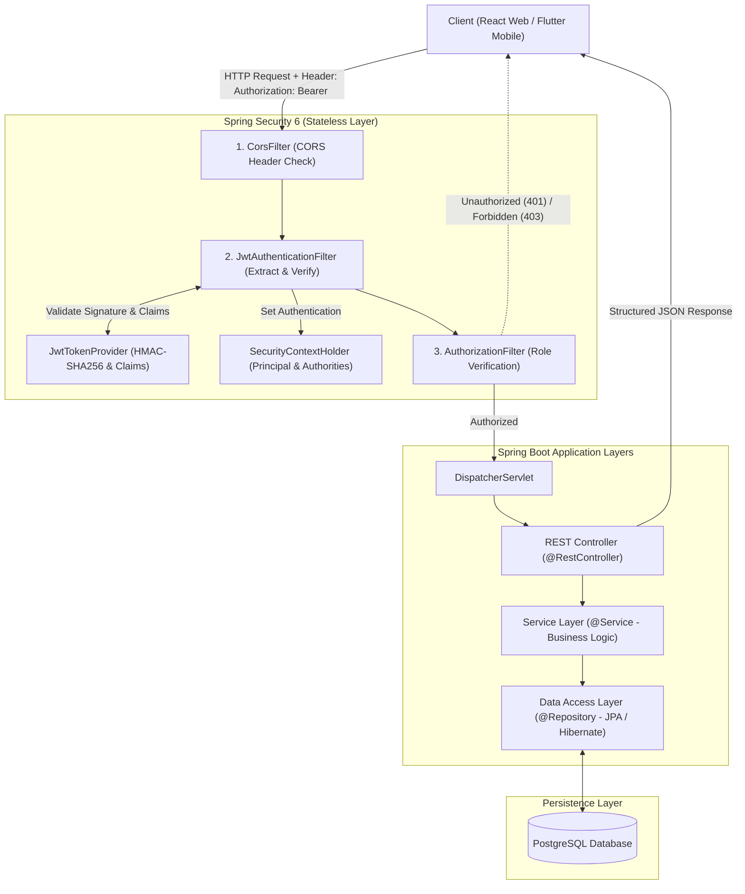
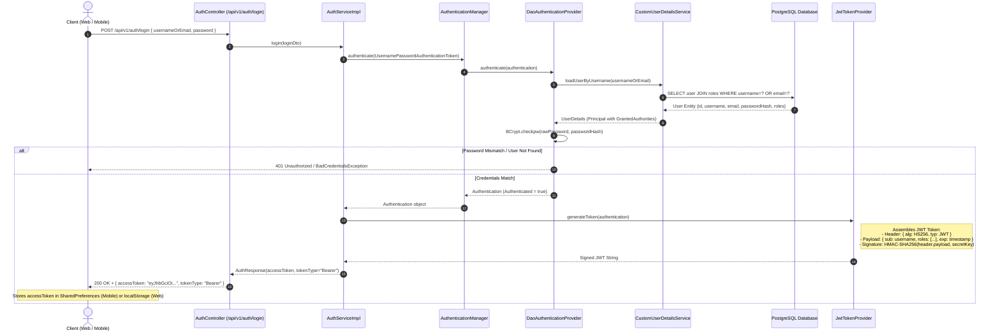
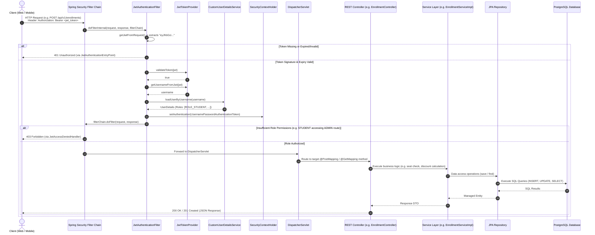

# School Management System - Backend (Spring Boot 3)

Backend RESTful API service for the School Management System built with Spring Boot 3, Spring Data JPA, PostgreSQL, Spring Security 6 with JWT, and Docker.

> 🔗 **Frontend Web Application Repository**: [https://github.com/YimLemeng/School-management-system-web](https://github.com/YimLemeng/School-management-system-web)

---

## 🚀 Features

- **Authentication & Authorization**:
  - Role-based Access Control (`ROLE_ADMIN`, `ROLE_TEACHER`, `ROLE_STUDENT`)
  - Stateless JWT token authentication
  - User self-registration with automatic student profile provisioning
- **Academic Management**:
  - **Departments**: Manage academic faculties & departments (code, name, office location, contact email, active status)
  - **Teachers**: Manage instructors with department affiliations and academic qualifications
  - **Courses**: Manage course offerings, credit hours, seat capacities, teacher assignments, and department relationships
  - **Students**: Student records, demographic info, and enrollment tracking
  - **Enrollments**: Transactional course enrollment, automatic seat inventory deduction, discount percentage calculation, receipt generation, and dropping/canceling courses with automatic seat restocking
  - **Enrollment Confirmation & Business Rules**: Confirm enrollments (`PATCH /api/v1/enrollments/{id}/confirm`); confirmed enrollments are strictly non-cancellable (`BadRequestException`)
- **Database Migrations & Seeding**:
  - Flyway migration scripts (`src/main/resources/db/migration/V1__init_schema.sql`) for reliable schema versioning
  - Automated PostgreSQL container seed scripts (`init-db/01-init.sql`)
- **Architecture**:
  - Layered Clean Architecture (Controller -> Service -> Repository -> Entity)
  - Data Transfer Objects (DTOs) and ModelMapper
  - JPA Specifications for dynamic filtering, searching, and pagination
  - Global Exception Handling with structured API responses

---

## 🛠️ Tech Stack

- **Java**: 21 (Eclipse Temurin)
- **Framework**: Spring Boot 3.x
- **Database**: PostgreSQL
- **Security**: Spring Security 6 & JWT (jjwt 0.12.6)
- **Database Migrations**: Flyway
- **Build Tool**: Maven (`mvnw`)
- **Containerization**: Docker & Docker Compose
- **API Documentation**: OpenAPI 3 / Swagger (`/swagger-ui.html`)

---

## 🔐 Security Architecture & Request Flow

The backend uses **stateless token-based authentication** powered by Spring Security 6 and JSON Web Tokens (JWT). The server does not store user sessions in memory; instead, every client request carries a digitally signed cryptographic token.

### 1. High-Level Request Pipeline



---

### 2. User Authentication Flow (Login & Token Issuance)

When a user signs in, credentials are submitted, verified with BCrypt against the PostgreSQL database, and a cryptographically signed JWT is returned to the client:



---

### 3. Authenticated Request Flow (Accessing Protected Endpoints)

For subsequent requests (e.g. creating courses, enrolling students, managing departments), the client sends the token in the `Authorization` header:



---

### 4. End-to-End Workflow Summary

1. **User Authentication (Login)**:
   - **Client Request**: The client application (React Web or Flutter Mobile) sends `usernameOrEmail` and `password` via `POST /api/v1/auth/login`.
   - **Credential Verification**: `AuthenticationManager` delegates to `DaoAuthenticationProvider`, which fetches user credentials through `CustomUserDetailsService` and validates the password against the stored database hash using `BCrypt`.
   - **Token Generation**: Upon successful authentication, `JwtTokenProvider` crafts a cryptographically signed **JWT Access Token** embedded with the username as subject, user roles (`ROLE_ADMIN`, `ROLE_TEACHER`, `ROLE_STUDENT`), issue timestamp, and expiration time, digitally signed using HMAC-SHA256 (`HS256`).
   - **Token Storage**: The server returns an `AuthResponse` object containing the `accessToken`. The client securely stores the token in local storage (`SharedPreferences` on mobile, `localStorage` on web) to authenticate subsequent requests.

2. **Authenticated Client Request Execution**:
   - **Header Attachment**: For every subsequent protected API call (e.g., managing courses, registering students, enrolling in classes), the client attaches the HTTP header `Authorization: Bearer <token>`.
   - **Filter Interception**: `JwtAuthenticationFilter` intercepts the request before it reaches any controller:
     - **Missing or Expired Token**: Immediately rejected with **401 Unauthorized** via `JwtAuthenticationEntryPoint`.
     - **Valid Token**: Extracts the username and authorities, constructs a `UsernamePasswordAuthenticationToken`, and injects it into `SecurityContextHolder`.
   - **Role-Based Authorization (RBAC)**: Spring Security verifies endpoint permissions:
     - **Insufficient Privileges** (e.g., a `STUDENT` attempting to delete a teacher or modify course offerings): Immediately rejected with **403 Forbidden** via `JwtAccessDeniedHandler`.
     - **Authorized**: The request is routed through the Spring MVC pipeline:
       `DispatcherServlet` &rarr; `@RestController` &rarr; `@Service` (Business Logic) &rarr; `@Repository` (JPA) &rarr; `PostgreSQL Database`.
   - **Structured Response**: The business logic executes, database changes are committed, and the controller returns a structured JSON `ApiResponse<T>` with HTTP status code `200 OK` or `201 Created` back to the client.

---

## 📡 REST API Reference

| Module | Method | Endpoint | Description | Access |
| :--- | :--- | :--- | :--- | :--- |
| **Auth** | `POST` | `/api/v1/auth/login` | Authenticate user & return JWT token | Public |
| **Auth** | `POST` | `/api/v1/auth/register` | Register new user (auto student profile) | Public |
| **Auth** | `GET` | `/api/v1/auth/me` | Fetch authenticated user details | Authenticated |
| **Auth** | `POST` | `/api/v1/auth/change-password` | Update current user password | Authenticated |
| **Departments** | `GET` | `/api/v1/departments` | List all departments | `ADMIN` |
| **Departments** | `GET` | `/api/v1/departments/{id}` | Get department by ID | `ADMIN` |
| **Departments** | `POST` | `/api/v1/departments` | Create new department | `ADMIN` |
| **Departments** | `PUT` | `/api/v1/departments/{id}` | Update existing department | `ADMIN` |
| **Departments** | `DELETE`| `/api/v1/departments/{id}` | Delete department | `ADMIN` |
| **Teachers** | `GET` | `/api/v1/teachers` | List teachers with pagination & filters | `ADMIN` |
| **Teachers** | `GET` | `/api/v1/teachers/{id}` | Get teacher profile by ID | `ADMIN` |
| **Teachers** | `POST` | `/api/v1/teachers` | Create teacher record | `ADMIN` |
| **Teachers** | `PUT` | `/api/v1/teachers/{id}` | Update teacher profile | `ADMIN` |
| **Teachers** | `DELETE`| `/api/v1/teachers/{id}` | Delete teacher record | `ADMIN` |
| **Students** | `GET` | `/api/v1/students` | List students with search & pagination | `ADMIN`, `TEACHER` |
| **Students** | `POST` | `/api/v1/students` | Create student record | `ADMIN`, `TEACHER` |
| **Students** | `PUT` | `/api/v1/students/{id}` | Update student record | `ADMIN`, `TEACHER` |
| **Students** | `DELETE`| `/api/v1/students/{id}` | Delete student record | `ADMIN` |
| **Courses** | `GET` | `/api/v1/courses` | List courses with capacity & filters | `ADMIN`, `TEACHER`, `STUDENT` |
| **Courses** | `POST` | `/api/v1/courses` | Create new course | `ADMIN`, `TEACHER` |
| **Courses** | `PUT` | `/api/v1/courses/{id}` | Update course details | `ADMIN`, `TEACHER` |
| **Courses** | `DELETE`| `/api/v1/courses/{id}` | Delete course | `ADMIN` |
| **Enrollments** | `GET` | `/api/v1/enrollments` | List all enrollments | `ADMIN`, `TEACHER` |
| **Enrollments** | `GET` | `/api/v1/enrollments/student/{id}`| List enrollments for a student | Authenticated |
| **Enrollments** | `GET` | `/api/v1/enrollments/course/{id}`| List enrollments for a course | Authenticated |
| **Enrollments** | `POST` | `/api/v1/enrollments` | Enroll student into a course | Authenticated |
| **Enrollments** | `PATCH/POST` | `/api/v1/enrollments/{id}/confirm`| Confirm enrollment status | `ADMIN`, `TEACHER` |
| **Enrollments** | `PATCH/POST` | `/api/v1/enrollments/{id}/cancel` | Cancel enrollment & restock seat | `ADMIN` |

---

## ⚙️ Getting Started

### 1. Prerequisites
- Java 21+ installed
- PostgreSQL 15+ installed or running via Docker

### 2. Environment Configuration
Copy the template `.env.example` file to `.env`:
```bash
cp .env.example .env
```
Update your credentials in `.env`:
```env
# Database Credentials
POSTGRES_DB=school_management_db
POSTGRES_USER=school_management
POSTGRES_PASSWORD=your_secure_password_here

# Spring Datasource Configuration (Local Maven execution)
SPRING_DATASOURCE_URL=jdbc:postgresql://localhost:5432/school_management_db
SPRING_DATASOURCE_USERNAME=school_management
SPRING_DATASOURCE_PASSWORD=your_secure_password_here
SPRING_JPA_HIBERNATE_DDL_AUTO=validate
SERVER_PORT=8080

# JWT Security Configuration
JWT_SECRET=your_jwt_secret_key_minimum_256_bits_here
JWT_EXPIRATION_MS=86400000

# Swagger / OpenAPI API Documentation (Set to false in Production)
SWAGGER_ENABLED=false
```

### 3. Run Locally (Maven)
```bash
./mvnw clean spring-boot:run
```

### 4. Run with Docker Compose
Docker Compose automatically loads `.env` to configure the PostgreSQL database container (`school_db`) with healthchecks and starts the Spring Boot API service (`school_api`):
```bash
docker compose up --build -d
```

---

## 🔒 Security & Sensitive Data
- Database credentials and secrets are managed via environment variables and excluded from version control (`.gitignore`).
- Never commit `.env` or production credentials.
